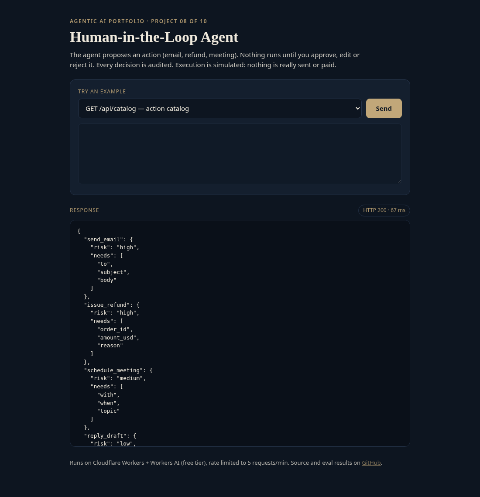
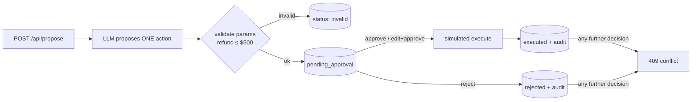

# agent-08-human-in-loop

**Human-in-the-Loop Agent: propose, approve, audit**

**Live demo:** https://agent-08-human-in-loop.braylo777.workers.dev



## What it is
An operations agent that may only *propose* actions (send email, issue refund, schedule meeting, draft reply). Nothing executes until a human approves, edits-then-approves, or rejects it, and every decision is audited. Project 8 of a 10-part agentic AI portfolio. Execution is simulated: nothing is really sent or paid.

## Architecture


## How it works
- `src/hitl.js`: action catalog with risk levels, schema validation, propose/decide state machine (only `pending_approval` can change), audit trail.
- Edited params are re-validated, so a human edit can't push a refund over the limit.
- `src/index.js`: `/api/propose`, `/api/decide`, `/api/actions/:id`, `/api/catalog`.
- Runs serverless on Cloudflare Workers with the free Workers AI tier (`@cf/meta/llama-3.3-70b-instruct-fp8-fast`); 5 requests/min per IP keeps the demo free.

## Eval results
Measured against the **live** deployment with real model calls (`node evals/run.mjs`), run 2026-10-28. Raw per-case output: [`evals/results.json`](evals/results.json). Small sample sizes, kept small to stay inside the free daily model quota, so read these as indicative, not definitive.

| Metric | Result |
|---|---|
| Proposal correctness (expected action + valid params) | 16/16 (100%) |
| Approval-gate enforcement (gate checks passed) | 29/29 (100%) |
| Latency p50 / p95 (end-to-end HTTP) | 1701 ms / 3653 ms (n=16) |

## Tests
12/12 unit tests pass (`npm test`, Node 20+, the LLM is mocked so they run offline).

## Run it
```bash
npm install
npm test               # offline unit tests
node evals/run.mjs     # live evals (BASE=http://localhost:8787 for local)
npx wrangler dev       # local; Workers AI via your Cloudflare login
npx wrangler deploy    # free tier, no paid API keys
```

## License
MIT
