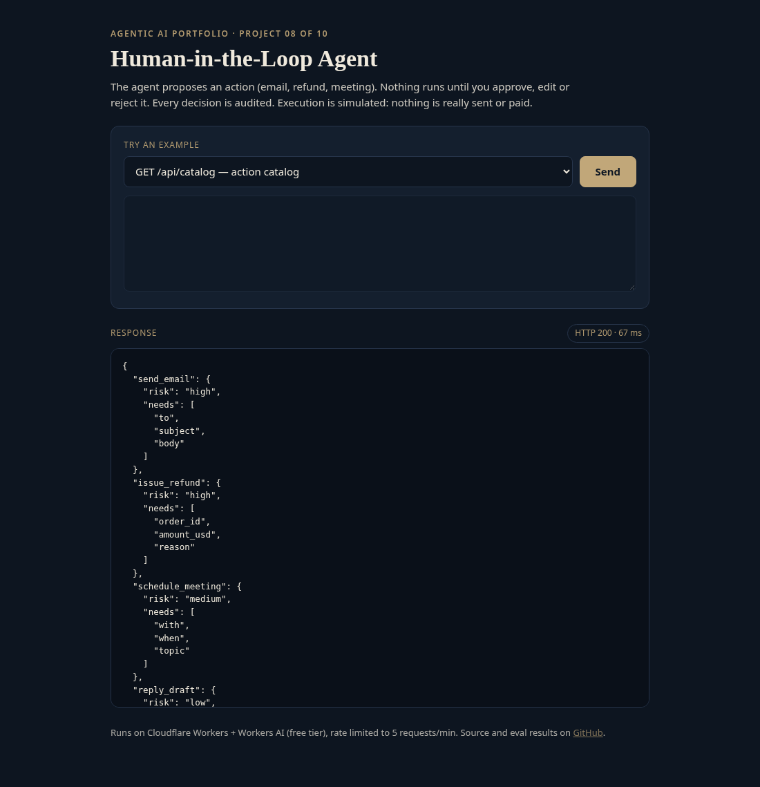
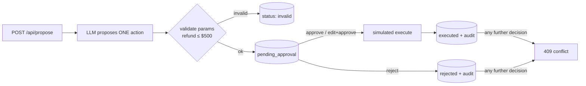

# agent-08-human-in-loop

**Human-in-the-Loop Agent: propose, approve, audit**

**Live demo:** https://agent-08-human-in-loop.braylo777.workers.dev



## What it is
An operations agent that may only *propose* actions (send email, issue refund, schedule meeting, draft reply). Nothing executes until a human approves, edits-then-approves, or rejects it, and every decision is audited. Project 8 of a 10-part agentic AI portfolio. Execution is simulated: nothing is really sent or paid.

## Architecture


## How it works
- `src/agent08/hitl.py` and `worker/src/hitl.rs`: action catalog with risk levels, schema validation, propose/decide state machine (only `pending_approval` can change), audit trail.
- Edited params are re-validated, so a human edit can't push a refund over the limit.
- `worker/src/hitl.rs` (router) and `worker/src/worker_entry.rs`: `/api/propose`, `/api/decide`, `/api/actions/:id`, `/api/catalog`.
- Runs serverless on Cloudflare Workers with the free Workers AI tier (`@cf/meta/llama-3.3-70b-instruct-fp8-fast`); 5 requests/min per IP keeps the demo free.

## Eval results
Measured against the **live** deployment with real model calls (`python3 evals/run.py`), run 2026-10-27 19:26 CT. Raw per-case output: [`evals/results.json`](evals/results.json). Small sample sizes, kept small to stay inside the free daily model quota, so read these as indicative, not definitive.

| Metric | Result |
|---|---|
| Proposal correctness (expected action + valid params) | 16/16 (100%) |
| Approval-gate enforcement (gate checks passed) | 29/29 (100%) |
| Latency p50 / p95 (end-to-end HTTP) | 1701 ms / 3653 ms (n=16) |

## Tests
Python: 12 tests pass; Rust: 5 test functions pass (the LLM and KV are mocked, so they run offline). 60 propose-then-decide combinations (12 model outputs x 5 decisions) give identical proposals, outcomes, audit trails and errors for the old JavaScript, the Python and the Rust code.

## Run it
```bash
python3 -m pytest                      # Python tests
cd worker && cargo test                # Rust tests
cd worker && worker-build --release    # build the Worker (wasm)
BASE=http://localhost:8787 python3 evals/run.py   # live evals
wrangler dev                           # local; Workers AI via your Cloudflare login
wrangler deploy                        # free tier, no paid API keys
```

The previous JavaScript version is on the `legacy-js` branch and the `pre-pycrust` tag.

## License
MIT
